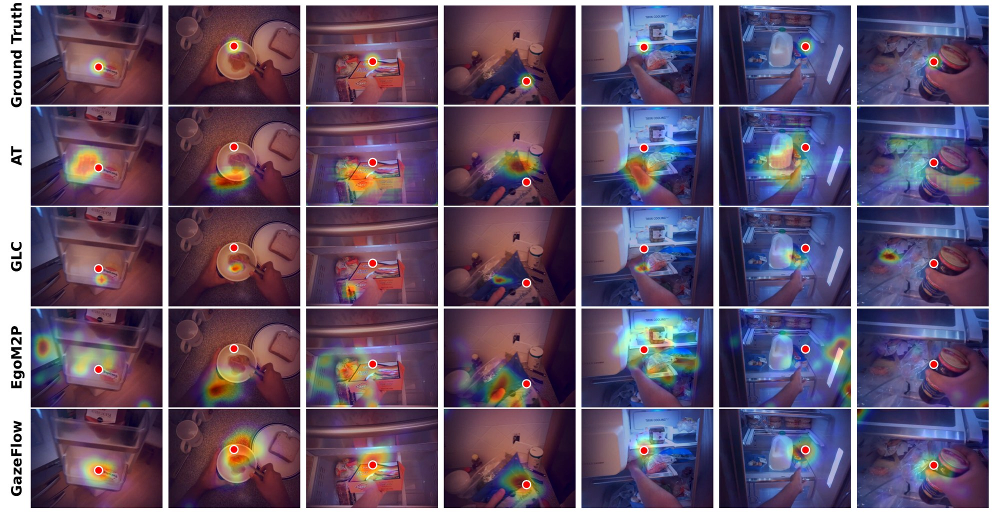
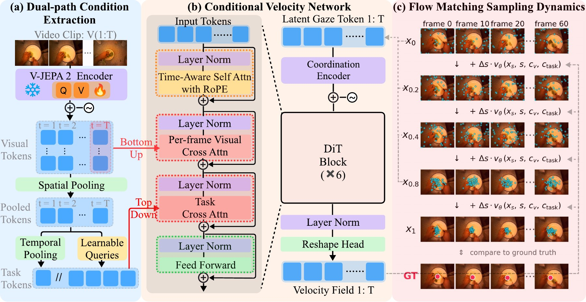

<div align="center">

# GazeFlow: From Human Gaze Behavior to Generative Egocentric Gaze Prediction

**NeurIPS 2026**

[Sheng Zhao](https://zhaosheng-thu.github.io/) · [Weikai Lin](https://linwk20.github.io/) · [Yuhao Zhu](https://yuhaozhu.com/)

University of Rochester

[](https://arxiv.org/abs/2609.38519)
[](https://zhaosheng-thu.github.io/gazeflow/)
[](LICENSE)

</div>

<p align="center">
  
</p>
<p align="center"><sub>Predicted gaze heatmaps on EGTEA Gaze+. Red dots mark the ground-truth gaze.</sub></p>

Official implementation of **GazeFlow** (NeurIPS 2026). For more details,
see our **[project page](https://zhaosheng-thu.github.io/gazeflow/)**.

## How it works

GazeFlow generates the gaze trajectory of a whole clip with conditional flow
matching. The three parts of the figure below map to the code as follows.

<p align="center">
  
</p>

- **(a) Dual-path condition extraction** (`backbone.py`, `model.py`). A V-JEPA 2
  encoder, frozen except for LoRA on its query and value layers, turns every
  frame into visual tokens: the *bottom-up* condition. Pooling these tokens
  over space and time, together with a few learnable queries, gives a small
  set of task tokens that summarize the clip: the *top-down* condition.
- **(b) Conditional velocity network** (`model.py`, `blocks.py`). The noisy
  trajectory enters as one token per frame. Each of the 6 blocks applies
  self-attention across frames (with RoPE), cross-attention from each frame to
  its own visual tokens, cross-attention to the task tokens, and a feed-forward
  layer. The network outputs a velocity for every frame.
- **(c) Flow-matching sampling** (`model.py`, `sampling.py`). Starting from
  Gaussian noise, the trajectory moves along the predicted velocity for S Euler
  steps. Repeating this K times gives K trajectories; together they form the
  predicted gaze heatmap of every frame.

## Installation

```bash
conda create -n gazeflow python=3.11 -y
conda activate gazeflow
pip install -r requirements.txt
```

A single GPU with about 16 GB of memory is enough.

## Getting started

### 1. Download EGTEA Gaze+

```bash
bash scripts/download_egtea.sh
```

This downloads the trimmed clips (~22 GB) and the gaze data from the official
EGTEA Gaze+ release and unpacks them into `data/egtea/`:

```
data/egtea/
├── cropped_clips/<session>/<clip>.mp4
└── gaze_data/<session>.txt
```

If you already have EGTEA Gaze+ in this layout elsewhere, skip this step and
add `--egtea-root /path/to/egtea` to the commands below.

### 2. Get the model weights

The GazeFlow checkpoint is already in this repository
(`checkpoints/gazeflow.pt`). The V-JEPA 2 encoder is downloaded from Hugging
Face automatically on the first run. On a machine without internet access,
download it beforehand:

```bash
python -c "from huggingface_hub import snapshot_download; snapshot_download('facebook/vjepa2-vitl-fpc64-256', local_dir='checkpoints/vjepa2-vitl-fpc64-256')"
```

and add `--backbone-path checkpoints/vjepa2-vitl-fpc64-256` to the command in step 3.

### 3. Generate gaze trajectories

```bash
python scripts/sample.py
```

This samples K = 50 trajectories with S = 50 steps for each of the 2,021
evaluation clips listed in `data/manifests/egtea_val.jsonl`, and saves them to
`runs/egtea_val/generated_scanpaths.npz` (clip id → array of shape `(K, T, 2)`,
pixel coordinates in the 640×480 frame).

- Quick test on one clip: `python scripts/sample.py --max-clips 1 --num-samples 5 --num-ode-steps 10`
- Faster setting with similar accuracy: `--num-samples 30 --num-ode-steps 5`
  (about 4.6× faster than the default on an H100).

### 4. Evaluate

```bash
python scripts/evaluate.py
```

This prints AUC, F1, precision (P), recall (R), and average angular error (AAE).

## Results

Main results on EGTEA Gaze+ (K = 50, S = 50):

| Method | AUC ↑ | F1 ↑ | P ↑ | R ↑ | AAE ↓ |
|---|:-:|:-:|:-:|:-:|:-:|
| GLC | 0.953 | 0.421 | 0.348 | 0.531 | 10.21 |
| AT | 0.956 | 0.419 | 0.339 | 0.547 | 9.88 |
| EgoM2P (LoRA) | 0.921 | 0.293 | 0.205 | 0.515 | 12.81 |
| **GazeFlow (ours)** | **0.964** | **0.491** | **0.414** | **0.603** | **9.01** |

## Repository structure

```
checkpoints/gazeflow.pt     trained model (flow network, LoRA weights, settings)
data/manifests/             evaluation clip list
scripts/download_egtea.sh   download EGTEA Gaze+
scripts/sample.py           generate gaze trajectories
scripts/evaluate.py         compute the metrics
src/gazeflow/
  backbone.py               V-JEPA 2 + LoRA, per-frame features
  model.py                  velocity network and Euler sampler
  blocks.py                 network blocks
  spatial_encoder.py        attention over the patches of each frame
  time_embed.py             time-step embedding
  sampling.py               whole-clip sampling with overlapping 64-frame windows
  egtea.py                  ground truth from the EGTEA Gaze+ gaze files
  metrics.py                AUC, F1, AAE
```

## Citation

If you find this work useful, please cite:

```bibtex
@inproceedings{zhao2026gazeflow,
  title     = {GazeFlow: From Human Gaze Behavior to Generative Egocentric Gaze Prediction},
  author    = {Zhao, Sheng and Lin, Weikai and Zhu, Yuhao},
  booktitle = {Advances in Neural Information Processing Systems (NeurIPS)},
  year      = {2026}
}
```

## Acknowledgements

We thank the authors of [EGTEA Gaze+](https://cbs.ic.gatech.edu/fpv/),
[V-JEPA 2](https://github.com/facebookresearch/vjepa2), and
[GLC](https://github.com/BolinLai/GLC) for releasing their data, models, and code.

## License

This code is released under the [MIT License](LICENSE). EGTEA Gaze+ and V-JEPA 2
are covered by their own licenses.
